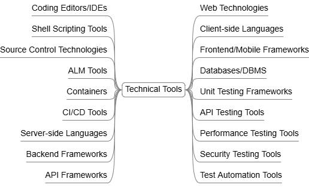

# Technical Tools

Essential Usage Guide for Software Development & Quality Engineering Tools

_Technical Tools, Editors, IDE's, Shells, SCM, ALM, Programming Languages, Scripting Languages, Frameworks, Databases, DBMS, APIs, Web Technologies, Automation, Containers, CI/CD_

## [Coding Editors/IDEs](IDEs/README.md)

Visual Studio Code, Visual Studio IDE, IntelliJ IDEA

## [Shell Scripting Tools](ShellScripting/README.md)

PowerShell, Command Prompt, Bash

## [Source Control Technologies](SourceControl/README.md)

Git, GitHub

## [ALM Tools](ALM/README.md)

Jira, Azure DevOps

## [Containers](Containers/README.md)

Docker

## [CI/CD Tools](CICD/README.md)

Azure Pipelines, GitHub Actions, Jenkins

## [Server-side Languages](ServerLanguages/README.md)

C#.NET, Java

## [Backend Frameworks](BackendFrameworks/README.md)

ASP.NET

## [API Frameworks](APIs/README.md)

Web API, WCF Services

## [Web Technologies](WebTechnologies/README.md)

HTML, CSS, XML

## [Client-side Languages](ClientsideLanguages/README.md)

JavaScript, TypeScript

## [Frontend/Mobile Frameworks](FrontendFrameworks/README.md)

Blazor, Angular, Vue.js, .NET MAUI

## [Databases/DBMS](Databases/README.md)

SQL Server, Oracle Database, PostgreSQL

## [Unit Testing Frameworks](UnitTesting/README.md)

NUnit, MSTest, xUnit.net, Chai/Mocha, TestNG

## [API Testing Tools](ApiTesting/README.md)

Postman, SoapUI, RestAssured

## [Performance Testing Tools](PerformanceTesting/README.md)

JMeter

## [Security Testing Tools](SecurityTesting/README.md)

OWASP ZAP

## [Test Automation Tools](TestAutomation/README.md)

Selenium, Playwright, Appium, Cucumber/Reqnroll